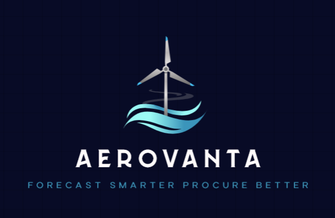
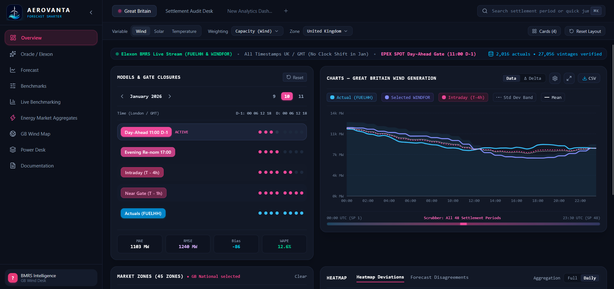
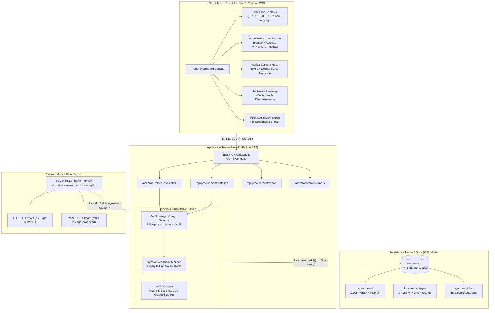

<p align="center">
  
</p>

<p align="center">
  <strong>GB Wind Generation Forecast Intelligence & Day-Ahead Procurement Audit Platform</strong><br>
  <em>Reconstructing Decision-Time Forecast Accuracy Across the Great Britain Power Grid (January 2026)</em>
</p>

<p align="center">
  <a href="https://aerovanta-lyart.vercel.app" target="_blank"></a>
</p>

<p align="center">
  <a href="#9-automated-verification--test-suite"></a>
  <a href="#7-getting-started"></a>
  <a href="#6-api-specification"></a>
  <a href="#7-getting-started"></a>
  <a href="#7-getting-started"></a>
  <a href="#7-getting-started"></a>
  <a href="LICENSE"></a>
</p>

---

<p align="center">
  
</p>
<p align="center">
  <em>Figure 1: AEROVANTA Live Desk — Interactive Models & Gate Closures, Multi-Series Generation Curves (Actual FUELHH vs Selected WINDFOR vs Intraday T-4h), Regional Offshore Wind Arrays, and Settlement Variance Heatmap for January 2026.</em>
</p>

---

A high-performance quantitative forecasting and procurement audit platform engineered for Great Britain (GB) power market trading and dispatch desks. AEROVANTA ingests, reconciles, and evaluates half-hourly wind generation forecasts against metered physical outturns using official **Elexon BMRS** data feeds across **January 2026**.

The platform provides a mathematically verified **zero forward-looking data leakage guarantee**, allowing power traders, utility procurement analysts, and risk managers to evaluate historical decision-time forecast accuracy at official market gate closures (e.g., EPEX SPOT Day-Ahead 11:00 GMT $D-1$).

---

## Table of Contents

1. [Market Context & Problem Formulation](#1-market-context--problem-formulation)
2. [Platform Architecture](#2-platform-architecture)
3. [Domain Specifications & Anti-Leakage Invariant](#3-domain-specifications--anti-leakage-invariant)
4. [Elexon BMRS Data Pipeline](#4-elexon-bmrs-data-pipeline)
5. [Quantitative Metrics Framework](#5-quantitative-metrics-framework)
6. [API Specification](#6-api-specification)
7. [Getting Started](#7-getting-started)
   - [Docker Compose (Containerized)](#option-a-docker-compose-recommended)
   - [Native Local Environment](#option-b-native-local-environment)
8. [CLI Data Synchronization Tool](#8-cli-data-synchronization-tool)
9. [Automated Verification & Test Suite](#9-automated-verification--test-suite)
10. [Repository Structure](#10-repository-structure)

---

## 1. Market Context & Problem Formulation

In the Great Britain wholesale electricity market (governed by the Balancing and Settlement Code — BSC Section T), electricity suppliers and generators balance their contracted physical positions prior to delivery.

```
       D-1 11:00 GMT          D-1 17:00 GMT            T - 4h               T - 1h              T (Delivery)
─────────────┬──────────────────────┬─────────────────────┬────────────────────┬─────────────────────┬───────►
      EPEX SPOT / NordPool     Intra-Utility         Intraday Rolling     Balancing Mechanism   Settlement Period
      Day-Ahead Auction Gate   Re-nomination Gate    Adjustments          Gate Closure (Freeze) (48 half-hours)
```

### The Cost of Wind Forecast Error
Because wind power in Great Britain regularly exceeds 20 GW of instantaneous generation, forecast variances lead to substantial physical imbalance liabilities:

- **System Long (Overforecast):** A utility procures volume based on an over-optimistic forecast. Physical generation falls short of contracted volume, leaving surplus unconsumed energy that gets settled at discount System Sell Prices (SSP).
- **System Short (Underforecast):** The utility under-procures relative to actual outturn, forcing National Grid ESO (the Electricity System Operator) to dispatch expensive balancing actions settled at System Buy Prices (SBP).

**AEROVANTA** reconstructs the exact vintage of wind generation forecasts available at each statutory cutoff point, computing realistic procurement errors and preventing the post-hoc bias introduced by evaluating against retrospectively updated forecast models.

---

## 2. Platform Architecture

AEROVANTA is architected as an event-consistent, low-latency analytical system optimized for sub-second trader interactions, deterministic query resolution, and zero-downtime client resilience.



### System Decomposition & Layer Responsibilities

#### Layer 1: Trader Workspace Presentation Tier (React 19 / Vite 8)
- **Interactive Multi-Series Recharts Canvas:** Renders actual metered generation (`FUELHH`), selected vintage curve (`WINDFOR`), near-term intraday trajectory ($T-4\text{h}$), and standard deviation dispersion bands. Supports full Settlement Period scrubbing (1–48) and one-click Gross vs. Net ($\Delta$) toggle.
- **Gate Closure Matrix:** Allows instant toggling between market gate rules (EPEX 11:00 D-1, Evening Re-nom 17:00, Intraday Rolling $T-4\text{h}$, and Near-Gate $T-1\text{h}$) with immediate client recalculation.
- **Regional Hub Vector Map:** Stylized SVG representation of Great Britain with offshore wind clusters (Moray & Seagreen, Dogger Bank, Hornsea, East Anglia, Walney) linking geographic capacity to system-wide outturn.
- **Dual Heatmap Matrix:** Visualizes daily forecast errors (+ for system long / - for system short) and cross-model spread divergences across the delivery month.

#### Layer 2: API Gateway & Application Tier (FastAPI / Uvicorn)
- **Non-blocking Asynchronous Execution:** Built on Starlette's async I/O loop to handle concurrent request bursts.
- **Pydantic v2 Type Safety:** Strict serialization and validation of delivery timestamps, settlement period bounds (1–48), and metric schemas.
- **Deterministic CSV Streamer:** Generates compliant CSV exports formatted for settlement reconciliation desks.

#### Layer 3: Domain & Quantitative Engine
- **RFC3339 Anti-Leakage Selector:** Reconciles ISO timestamps with millisecond precision, ensuring zero future vintages are considered.
- **Zero-Division Mathematical Safeguards:** Implements bounded denominator guards on WAPE and coverage calculations to eliminate divide-by-zero crashes.
- **Block-Hour Resolution Bridge:** Normalizes hourly forecast distributions to half-hourly settlement windows.

#### Layer 4: High-Performance Persistence Tier (SQLite WAL Mode)
- **Sub-5ms Query Latency:** Eliminates the 1–4s roundtrip latency of remote BMRS endpoints through compound B-tree indexed storage.
- **Write-Ahead Logging (WAL):** Supports concurrent non-blocking reads during background synchronization.
- **Pre-Hydrated Data Lake:** Ships with 2,016 metered wind records and 27,056 forecast vintages spanning all 31 days of January 2026.

---

## 3. Domain Specifications & Anti-Leakage Invariant

### The Zero Forward-Looking Leakage Guarantee
In historical accuracy auditing, any algorithm that selects a forecast vintage published *after* the decision cutoff violates fundamental causality, introducing survivorship and lookahead bias.

AEROVANTA enforces the following mathematical invariant across all 48 settlement periods:

$$\text{Eligible Vintages}(T, D) = \{ V \in \text{WINDFOR} \mid V.\mathrm{startTime} = T \land V.\mathrm{publishTime} \le D \}$$

$$\text{Selected Forecast}(T, D) = \arg\max_{V \in \text{Eligible Vintages}(T, D)} ( V.\mathrm{publishTime} )$$

Where:
- $T$ is the settlement period start timestamp (e.g., `2026-01-10T14:00:00Z`).
- $D$ is the statutory decision cutoff timestamp (e.g., `2026-01-09T11:00:00Z` for Day-Ahead 11:00 GMT).

### Gate Closure Presets
| Preset ID | Canonical Name | Target Cutoff Timestamp ($D$) | Market Rationale |
|---|---|---|---|
| `day_ahead_11am` | **Day-Ahead Standard** | `11:00:00Z` on Day $D-1$ | Official EPEX SPOT / Nord Pool GB Day-Ahead auction gate. |
| `day_ahead_5pm` | **Evening Re-nomination** | `17:00:00Z` on Day $D-1$ | Intra-utility trade rebalancing and interconnector nominations. |
| `intraday_4h` | **Intraday Rolling (T-4h)** | `start_time - 4 hours` | Rolling horizon for near-term physical positioning adjustments. |
| `intraday_1h` | **Near-Gate (T-1h)** | `start_time - 1 hour` | Physical gate closure prior to Balancing Mechanism submission. |
| *custom* | **Arbitrary User Cutoff** | Custom ISO 8601 string | Ad-hoc testing for custom trading strategies and lookaheads. |

### Temporal Resolution Mapping
- **FUELHH (Actuals):** Published at 30-minute intervals (48 settlement periods per standard day).
- **WINDFOR (Forecasts):** National Grid ESO publishes forecasts with hourly granularity for lookaheads beyond near-term.
- **Mapping Policy:** Half-hour intervals without an exact `:30:00Z` forecast vintage deterministically inherit the forecast from the `:00:00Z` parent block hour, flagged with `resolution_mode = "block_hour"`.

---

## 4. Elexon BMRS Data Pipeline

AEROVANTA ingests two primary streaming datasets directly from Elexon's Open Data API:

| Stream Code | Elexon Dataset Endpoint | Granularity | Ingestion Rule / Filter |
|---|---|---|---|
| **FUELHH** | `/datasets/FUELHH/stream` | Half-Hourly | Strictly filtered where `fuelType == 'WIND'`. Records instantaneous mean MW generation per settlement period. |
| **WINDFOR** | `/datasets/WINDFOR/stream` | Multi-vintage | Ingests rolling publication stream using a 3-day lookback prior to target delivery date to ensure all day-ahead and multi-day vintages are captured. |

### Power vs. Energy Units
- **Power ($\text{MW}$):** Instantaneous rate of electricity generation reported in both FUELHH and WINDFOR.
- **Delivered Energy ($\text{MWh}$):** Since settlement periods in GB are strictly 30 minutes ($0.5\text{ hours}$), energy delivered or procured is computed as:

$$\text{Energy (MWh)} = \text{Average Power (MW)} \times 0.5\text{ h}$$

---

## 5. Quantitative Metrics Framework

All error metrics are computed across the $N$ matched settlement periods of the target delivery day:

### 1. Signed Forecast Error (Directional Bias)
$$\text{Error}_i = \hat{y}_i - y_i \quad (\text{MW})$$

- $\text{Error}_i > 0$: **Overforecast (System Long)** — risk of surplus volume dumped at low System Sell Price.
- $\text{Error}_i < 0$: **Underforecast (System Short)** — risk of shortfall exposed to high System Buy Price.

### 2. Mean Absolute Error (MAE)
$$\text{MAE} = \frac{1}{N} \sum_{i=1}^{N} \left| \hat{y}_i - y_i \right| \quad (\text{MW})$$
Quantifies the average linear procurement error per half-hour period.

### 3. Root Mean Squared Error (RMSE)
$$\text{RMSE} = \sqrt{\frac{1}{N} \sum_{i=1}^{N} \left( \hat{y}_i - y_i \right)^2} \quad (\text{MW})$$
Penalizes severe peak volatility swings with a quadratic L2 norm.

### 4. Forecast Bias (Mean Error)
$$\text{Bias} = \frac{1}{N} \sum_{i=1}^{N} (\hat{y}_i - y_i) \quad (\text{MW})$$
Reveals structural over- or under-prediction tendency in the weather model.

### 5. Weighted Absolute Percentage Error (WAPE)
$$\text{WAPE} = \frac{\sum_{i=1}^{N} |\hat{y}_i - y_i|}{\sum_{i=1}^{N} y_i} \times 100\%$$
*Safeguard:* If total actual generation $\sum y_i = 0$, the metric safely returns `null` to prevent `ZeroDivisionError`.

---

## 6. API Specification

The FastAPI backend exposes fully typed REST endpoints with auto-generated OpenAPI documentation at `/docs`.

### Primary Endpoints

#### `GET /api/procurement/evaluation`
Evaluates day-ahead procurement accuracy for a target delivery date and cutoff rule.

**Query Parameters:**
- `date` (string, required): Delivery date in `YYYY-MM-DD` format (January 2026).
- `cutoff_preset` (string, optional): One of `day_ahead_11am`, `day_ahead_5pm`, `intraday_4h`, `intraday_1h`.
- `custom_cutoff` (string, optional): ISO 8601 timestamp string for ad-hoc cutoffs.

**Example Response:**
```json
{
  "target_date": "2026-01-10",
  "decision_cutoff": "2026-01-09T11:00:00Z",
  "cutoff_preset": "day_ahead_11am",
  "summary": {
    "total_settlement_periods": 48,
    "matched_periods": 48,
    "coverage_pct": 100.0,
    "total_actual_mwh": 108420.5,
    "total_procured_mwh": 115200.0,
    "net_imbalance_mwh": 6779.5,
    "mae_mw": 1103.4,
    "rmse_mw": 1240.2,
    "bias_mw": -86.1,
    "wape_pct": 12.6
  },
  "intervals": [
    {
      "settlement_period": 1,
      "start_time": "2026-01-10T00:00:00Z",
      "end_time": "2026-01-10T00:30:00Z",
      "actual_mw": 11840.0,
      "forecast_mw": 11420.0,
      "error_mw": -420.0,
      "abs_error_mw": 420.0,
      "publish_time": "2026-01-09T09:00:00Z",
      "lead_time_hours": 15.0,
      "resolution_mode": "exact",
      "status": "matched"
    }
  ]
}
```

#### `GET /api/procurement/vintages`
Retrieves all historical forecast vintages published for a specific settlement interval.

**Query Parameters:**
- `start_time` (string, required): Interval start timestamp (e.g., `2026-01-10T14:00:00Z`).

#### `GET /api/procurement/export`
Exports matched interval calculations as a clean, standardized CSV file for financial audit desks.

#### `GET /api/procurement/status`
Returns database record counts, Elexon sync timestamps, and connection status.

#### `GET /api/health`
Lightweight health probe returning `{"status": "healthy", "service": "aerovanta-backend"}`.

---

## 7. Getting Started

### Option A: Docker Compose (Recommended)

Requires [Docker Desktop](https://www.docker.com/products/docker-desktop/) installed and running.

```bash
# 1. Clone the repository
git clone https://github.com/your-username/aerovanta.git
cd aerovanta

# 2. Build and start services
docker compose up --build
```

Once running:
- **Web Interface:** [http://localhost:3000](http://localhost:3000)
- **FastAPI OpenAPI Swagger:** [http://localhost:8000/docs](http://localhost:8000/docs)
- **API Health Check:** [http://localhost:8000/api/health](http://localhost:8000/api/health)

---

### Option B: Native Local Environment

#### Prerequisites
- **Python 3.12+**
- **Node.js 20+** and **npm**

#### 1. Backend Service
```bash
cd backend

# Create and activate virtual environment
python -m venv venv
# On Windows:
.\venv\Scripts\activate
# On Linux / macOS:
source venv/bin/activate

# Install dependencies
pip install -r requirements.txt

# Run backend unit test suite
python -m pytest -v

# Start FastAPI development server
python -m uvicorn app.main:app --host 0.0.0.0 --port 8000 --reload
```

#### 2. Frontend Client
```bash
cd frontend

# Install dependencies
npm install --legacy-peer-deps

# Start Vite development server
npm run dev
```

Open [http://localhost:5173](http://localhost:5173) in your browser.

---

## 8. CLI Data Synchronization Tool

A standalone command-line interface is included for auditing the SQLite cache or synchronizing fresh ranges from Elexon BMRS:

```bash
cd backend

# 1. Display current database statistics and row counts
python -m app.cli status

# 2. Sync full January 2026 data from Elexon BMRS streams
python -m app.cli sync --start 2026-01-01 --end 2026-01-31

# 3. Synchronize specific multi-day trading windows
python -m app.cli sync --start 2026-01-10 --end 2026-01-15
```

---

## 9. Automated Verification & Test Suite

The backend contains a test suite covering domain logic, anti-leakage invariants, mathematical error functions, and API response schemas:

```bash
cd backend
python -m pytest -v
```

### Verified Test Cases (10/10 Passing)

| Test File | Test Name | Invariant Verified |
|---|---|---|
| `test_vintage_rule.py` | `test_forecast_vintage_cutoff_no_future_leakage` | Verifies that a forecast published after the cutoff (e.g., 14:00 vs 11:00 D-1) is **never** selected for an interval. |
| `test_vintage_rule.py` | `test_cutoff_selection_intraday_rolling` | Verifies dynamic $T - 4\text{h}$ lookahead boundary selection. |
| `test_vintage_rule.py` | `test_missing_data_reporting` | Ensures missing records produce explicit `missing_forecast` or `missing_actual` statuses rather than silent zeros. |
| `test_metrics.py` | `test_calculate_metrics_standard` | Validates MAE, RMSE, Bias, and WAPE math against hand-calculated fixtures. |
| `test_metrics.py` | `test_calculate_metrics_zero_actual_safeguard` | Validates zero-actual safeguard preventing `ZeroDivisionError`. |
| `test_metrics.py` | `test_calculate_metrics_empty_or_unmatched` | Validates empty dataset handling returning zeroed summary metrics. |
| `test_api.py` | `test_health_endpoint` | Probes `/api/health` response schema and status code 200. |
| `test_api.py` | `test_evaluation_endpoint_validation` | Verifies date parameter validation and interval count (48 settlement periods). |
| `test_api.py` | `test_evaluation_endpoint_invalid_date` | Asserts HTTP 422 Unprocessable Entity on non-RFC3339 date input. |
| `test_api.py` | `test_status_endpoint` | Validates `/api/procurement/status` payload and database health reporting. |

---

## 10. Repository Structure

```
aerovanta/
├── backend/
│   ├── app/
│   │   ├── api/
│   │   │   └── procurement.py      # REST route handlers (/evaluation, /vintages, /export, /status)
│   │   ├── clients/
│   │   │   └── elexon.py           # Async HTTPX streaming client for Elexon BMRS
│   │   ├── domain/
│   │   │   ├── metrics.py          # Vectorized metrics engine (MAE, RMSE, Bias, WAPE)
│   │   │   └── vintage.py          # Deterministic anti-leakage vintage selector
│   │   ├── schemas/
│   │   │   └── procurement.py      # Pydantic v2 data models & request/response contracts
│   │   ├── cli.py                  # Ingestion & database maintenance CLI
│   │   ├── config.py               # Application settings & CORS configuration
│   │   ├── database.py             # SQLite WAL-mode connection & schema initialization
│   │   └── main.py                 # FastAPI application factory & lifespan handler
│   ├── data/
│   │   └── aerovanta.db            # Pre-seeded SQLite store (2,016 actuals + 27,056 vintages)
│   ├── tests/                      # Pytest test suite (10/10 passing)
│   ├── Dockerfile                  # Production Python 3.12 multi-stage containerfile
│   └── requirements.txt            # Locked backend dependencies
├── frontend/
│   ├── public/
│   │   ├── favicon.ico             # Offshore turbine icon
│   │   └── favicon.png             # Hi-res dark navy offshore turbine wave symbol
│   ├── src/
│   │   ├── components/
│   │   │   ├── BenchmarkDeskView.jsx      # Model ranking table with metric sorting
│   │   │   ├── ChartCard.jsx              # Recharts multi-series canvas with scrubber & delta mode
│   │   │   ├── DecisionMatrixCard.jsx     # Gate closure pills & 31-day January calendar popover
│   │   │   ├── DocumentationDeskView.jsx  # Technical market documentation & formulas
│   │   │   ├── HeaderBar.jsx              # Tab navigation, variable/weighting/zone controls
│   │   │   ├── HeatmapMatrixCard.jsx      # Daily error matrix & forecast disagreement matrix
│   │   │   ├── IntervalTable.jsx          # 48 Settlement period audit breakdown & status badges
│   │   │   ├── MarketZoneMapCard.jsx      # Offshore wind arrays interactive vector map & list
│   │   │   ├── OracleDeskView.jsx         # Elexon BMRS stream ingestion architecture view
│   │   │   ├── Sidebar.jsx                # Collapsible dark navigation sidebar
│   │   │   ├── StatusModal.jsx            # Data provenance modal with offline indicator
│   │   │   └── VintageEvolutionModal.jsx  # Modal for inspecting all revisions of an interval
│   │   ├── services/
│   │   │   ├── api.js                     # HTTP client with graceful offline fallback
│   │   │   └── fallbackData.js            # Embedded January 2026 dataset
│   │   ├── App.jsx                        # Master dashboard state orchestrator
│   │   ├── index.css                      # Tailwind styling & dark energy desk theme
│   │   └── main.jsx                       # React 19 entry point
│   ├── Dockerfile                         # Production Nginx multi-stage containerfile
│   ├── nginx.conf                         # Nginx reverse proxy configuration
│   └── package.json                       # Frontend dependencies & scripts
├── docker-compose.yml                     # Unified multi-service composition spec
└── README.md                              # This specification document
```

---

## License

This project is licensed under the MIT License — see the [LICENSE](LICENSE) file for details. Data provided by Elexon BMRS is subject to the [Elexon Open Data Policy](https://www.elexon.co.uk/).
